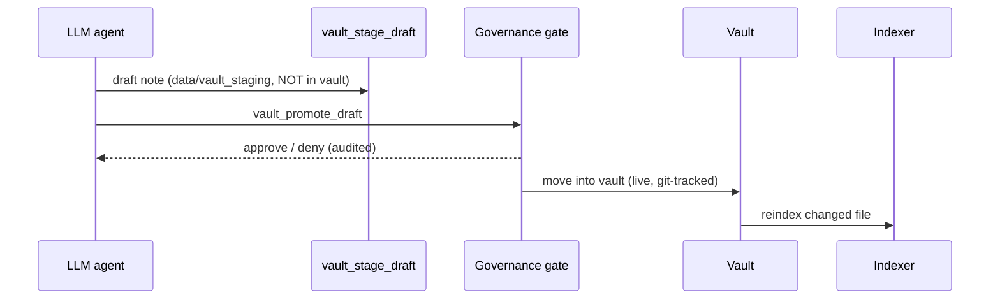

# Vault rebuild spec (any machine, any LLM)

**Reference deployment: Mac Mini** (Apple Silicon, macOS, Homebrew, `launchd`).
`vault-template/` is a sanitized starter vault (no private notes). This document
is the model-agnostic recipe: Claude, Codex, or any LLM/agent can follow it to
rebuild an equivalent vault + index. Everything below is taken from this repo's
code (`core/config.py`, `api/rag.py`, `vault/frontmatter.py`, `scripts/vault-backup.sh`).

## 1. Architecture

```mermaid
flowchart LR
  subgraph User data (outside repo)
    V[(Vault ~/Documents/Vault<br/>Markdown + frontmatter<br/>git-tracked, Obsidian)]
  end
  subgraph Index
    C[Chunker<br/>3000 chars, 200 overlap]
    E[Ollama nomic-embed-text]
    Q[(Qdrant :6333<br/>tenant_wilson-vault)]
  end
  subgraph msb-v3 :8766
    R[/rag API/]
    T[Vault tools<br/>stage draft -> promote]
    L[vault lint<br/>frontmatter + wikilinks]
    K[Cockpit /cockpit]
    G[Governance brakes<br/>approval + audit chain]
  end
  LLM[Ollama ornith:9b<br/>or any LLM via MCP/HTTP]
  B[vault-backup.sh<br/>weekly launchd]
  V -->|walk *.md| C --> E --> Q
  LLM <--> R --> Q
  LLM --> T --> G --> V
  V --> L --> K
  Q --> K
  B -->|snapshot repo into| V
```

## 2. Write path (why drafts are staged)



Unpromoted drafts live in `MSB_VAULT_STAGING_PATH` (default `<repo>/data/vault_staging`)
so they are never live, git-tracked, or RAG-indexed.

## 3. Contract (what an LLM must reproduce)

| Item | Rule |
|---|---|
| Location | `MSB_VAULT_PATH`, default `~/Documents/Vault`; outside the repo |
| Folders | `10_Projects/` `20_Research/` `30_Architecture/` (`decisions/`, `Wrongness-Engine/claims/`) `40_Memory/` `50_Experiments/workflows/` `Backups/` `lords-thoughts/{plans,archive,logs}/` |
| Notes | `*.md` only are indexed |
| Frontmatter | first line `---`, flat `key: value`, lists as `[a, b]`, closing `---`. Fields: `id` (unique), `type`, `title`, `created`, `updated` (`YYYY-MM-DD`, updated >= created), `tags` |
| Links | Obsidian `[[wikilinks]]` (stem, vault-relative path, or path suffix); no dangling links |
| Chunking | 3000-char windows, 200 overlap; point id = UUIDv5(`source#chunk`) so reindex replaces, never duplicates |
| Embeddings | `nomic-embed-text` (2048-token limit) via Ollama |
| Vector store | Qdrant `:6333`, collection `tenant_<tenant-id>`; run from repo root (storage = `./storage`) |
| Secrets | never in notes; `.env` excluded from backups |
| Validation | `msb_v3.vault.lint.lint_vault(root, required_fields=[...])` must report `clean` |

## 4. Rebuild steps (portable)

1. Create the folder tree in section 3 (copy `vault-template/`).
2. `git init` the vault; commit.
3. Set `MSB_VAULT_PATH` if not `~/Documents/Vault`.
4. Install Ollama; pull `nomic-embed-text` and a chat model (`make provision-models`).
5. Run Qdrant from the repo root (`scripts/start-qdrant.sh start` or `docker run -p 6333:6333 qdrant/qdrant`).
6. Start msb-v3 (`make server`, port 8766).
7. Index: walk `*.md`, chunk, embed, upsert into `tenant_<id>` with the stable ids above.
8. Verify: lint is clean; `/health` ok; a `/rag` query returns a note you wrote; `/cockpit` shows vault freshness.
9. Schedule weekly backup (`scripts/vault-backup.sh`; `launchd` on macOS, cron/systemd elsewhere).

## 5. Mac Mini vs. elsewhere

| Concern | Mac Mini | Portable swap |
|---|---|---|
| Python | `/opt/homebrew/Caskroom/miniforge/base/bin/python` | any 3.11+, set `MSB_PYTHON` |
| Supervision | `launchd` LaunchAgents (`scripts/launchd/`) | systemd/cron/Docker (`docker-compose.yml`) |
| Qdrant | local binary via `com.lordwilson.qdrant` | Docker image |
| Models | Ollama on Apple Silicon | any Ollama/llama.cpp host |

## 6. Prompt for any LLM

> Read `docs/vault-rebuild.md` and `vault-template/`. Recreate the vault at
> `$MSB_VAULT_PATH`, keep every note's frontmatter valid, index it into Qdrant
> as described, then prove it by running the lint and a RAG query. Report
> anything you could not verify.
